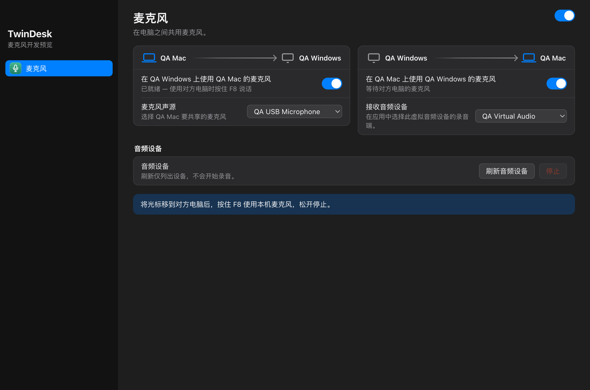
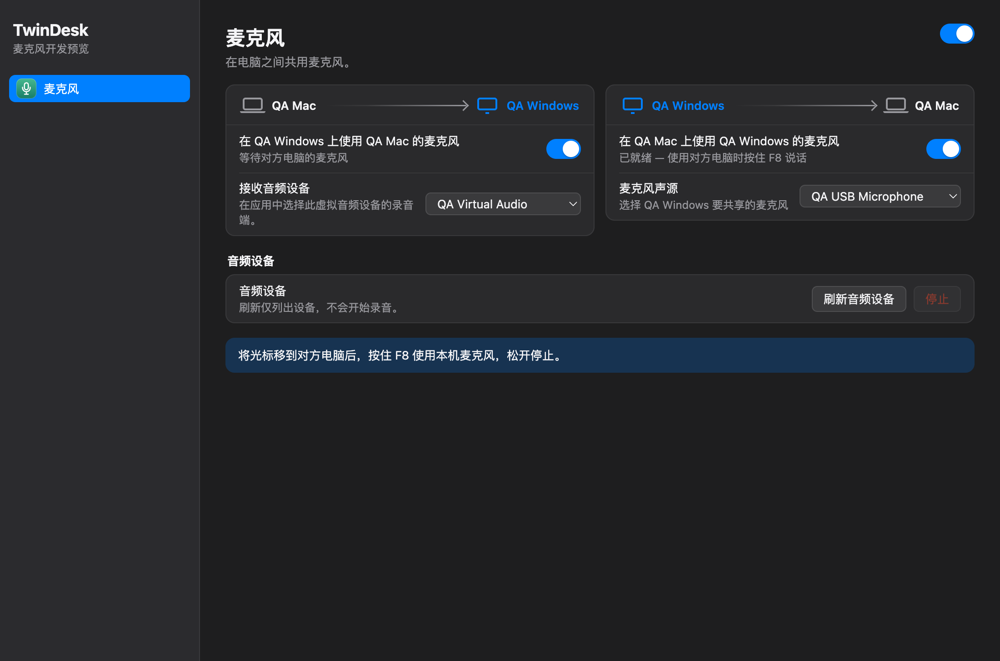

# TwinDesk 共享麦克风研究与首版候选

2026-11-03。上游基线为 `76b69c1d00609d5cb82e9e5cdfe2f42f8257955d`（`2.5.0-beta.1`）；个人 fork 的 `feature/shared-microphone` 分支。

本分支增加了 Mac / Windows 双机共享麦克风的开发候选，设置与传输代码均开放两个方向。**尚未完成真实 Windows 音频设备、输入法和双机验收，也没有替换本机已安装的 TwinDesk 或 Deskflow Voice。**

## 分页样式更新

麦克风分页现直接复用两端 Audio 分页的控件，而不是单列自定义设置：侧栏麦克风 SVG、页头总开关、关闭时的原版功能介绍、两张带电脑名称与箭头的方向卡片。Mac 使用 `UI.pair` / `UI.dir`，Windows 使用 `UI.dirCards`；字体、间距、按钮、开关与响应式布局沿用原样式。

两张卡片分别表示“在对方电脑使用本机麦克风”和“在本机使用对方麦克风”。各方向独立开关，总开关同时开关两向；状态通过原版 `pair.sync` 翻转 out/in，在另一台电脑同步，并按配对设备记忆。声源与接收音频设备在所属电脑本地选择。Windows 发送及 Mac 接收代码随双向配置补齐，但不代表真机验收。

界面截图使用真实 UI 组件及模拟电脑/设备名称，不代表真机连接。

## 声音转移是怎么实现的

- [mac/audiohub.js](https://github.com/InukaAsith/TwinDesk/blob/76b69c1d00609d5cb82e9e5cdfe2f42f8257955d/mac/audiohub.js)：Mac helper 的 ScreenCaptureKit 系统声音采集由 AudioHub 管理，屏幕与独立声音功能共享一次采集。PCM 通过 fd 3 和 Electron IPC 送进媒体窗口。
- [mac/audio-rtc.js](https://github.com/InukaAsith/TwinDesk/blob/76b69c1d00609d5cb82e9e5cdfe2f42f8257955d/mac/audio-rtc.js)：AudioWorklet → MediaStreamDestination → WebRTC，系统音频使用 Opus，SDP 配置立体声及 128 kbps 目标。
- [windows/sound.js](https://github.com/InukaAsith/TwinDesk/blob/76b69c1d00609d5cb82e9e5cdfe2f42f8257955d/windows/sound.js) / [sound-renderer.js](https://github.com/InukaAsith/TwinDesk/blob/76b69c1d00609d5cb82e9e5cdfe2f42f8257955d/windows/sound-renderer.js)：Windows 系统声音通过 Electron loopback 采集；另一方向用音频播放器播放 WebRTC track。
- 音频策略、SDP、ICE、停止信号经过已有配对连接；媒体另走 WebRTC。两个方向独立，也避免与屏幕声音重复发送。

这里已有的“声音播放转移”没有自动把收到的声音注册为 Windows 录音设备，也没有现有方案里的输入法 Begin/End 控制。

## 和现有方案的取舍

现有 Deskflow Voice 源码比较基线：`54d054927a91085381e77f31a520b61fe379b88c`。当前安装验收依据为其 `docs/build/desktop-preview.md`；历史路线不代替当前源码或设备验证。

| 方面 | TwinDesk 原实现 | 现有 Deskflow Voice | 本次决定 |
|---|---|---|---|
| 主要用途 | 系统声音在另一台电脑播放 | 按住说话，向当前 Windows 输入位置提供语音 | 单独增加“麦克风”，保留原声音页 |
| 网络 | 配对控制连接 + WebRTC/Opus 媒体 | 独立 TLS/V2，48 kHz 单声道 s16le PCM，以 Base64 放入 JSON | 借用既有连接发送协商消息，麦克风用 WebRTC |
| 录音生命周期 | 随声音功能的开关持续运行 | 新的按下开始；松开、切屏、断线等结束 | 候选使用物理 F8 DOWN/UP，跟随当前双机键鼠路由 |
| 接收端 | 音频播放器 | 虚拟音频入口 + 已安装输入法兼容适配 | 首版明确选择输出端，交给 Windows 应用选择对应录音端 |
| 输入法 | 没有此控制 | 已配置双机有真人连续输入及松开停止记录 | 暂不直接搬入；这是后续独立适配工作 |
| 设备与发行 | 已有多平台客户端、配对、媒体和安装工程 | 当前双机有安装记录；干净安装、其他方向等仍有边界 | 先做两端源码候选，真实设备验收后再考虑替换安装 |

不能据源码断言一方端到端延迟、识别率或稳定性一定更好。PCM 这条链路仅原始负载是 768 kbps，Base64 后约 1024 kbps（均不含协议开销）；Opus 能减小语音带宽，但具体码率、起音、尾音和失真仍应实测。新增发送器设置单声道、回声消除、降噪，并尝试为 sender 设置 48 kbps 上限；这不是实际码率测量结果。

## 这次加入的内容

- Mac 和 Windows 客户端在“音频”附近增加中英文“麦克风”页及麦克风图标；总开关、双向卡片和开关同步沿用原版方式，设置即时保存，升级默认关闭。
- 两端都可选择系统可见的麦克风和明确的接收音频设备；设备刷新只列出设备，不打开真实麦克风。
- 指针已移动到对方电脑后，麦克风所属电脑的实体 F8 开始本轮，松开停止；部分键盘需 Fn+F8。Ctrl/Alt/Shift/Command+F8 保留给原应用。
- 使用独立 `mic.*` 协商消息、随机连接 epoch 和会话 ID；拒绝旧路由、旧连接、已结束会话的迟到消息。
- 提前松开或断线时，即使操作系统稍后才返回麦克风授权，返回的 track 也会停止。
- 切回本机、锁屏、睡眠、helper 退出、媒体进程退出、设备消失、撤销接收与 5 秒心跳超时均结束本轮。重连或按键重复不自动重放说话。
- 接收前选择 sink；设备不存在或选择失败时结束本轮，不退回默认扬声器。必须由用户选择音频设备；程序不根据名字猜测驱动身份。
- 媒体窗口独立于屏幕分享，使用隔离持久会话保持设备 ID，限制麦克风/输出权限并禁止导航和新窗口。不改系统默认录音设备、扬声器音量或原声音功能。

当前开放 **Mac / Windows 桌面端的双向代码候选、一对一、IP 连接**。Mesh、Bluetooth 媒体、右 Option/Siri 遥控器触发、输入法自动唤起/停止仍未在此分支开放。两端仅列出浏览器可见的标准音频输入；特殊遥控器原始音频不能据此宣称已支持。

## 两端实际使用时的配置

两端都需要包含此分支代码；上游客户端不具备 `mic.*` 接收能力。

1. 两端配对，并开启原有键鼠跨屏功能。打开“麦克风”，使用页头总开关开启。
2. 用两张方向卡片分别允许“对方使用本机麦克风”和“本机使用对方麦克风”。切换会同步对方对应的方向，并按这组电脑记忆。
3. 在声源所属电脑选麦克风；接收电脑单独安装并确认虚拟音频设备，刷新后选择其播放端，再在目标应用选择对应录音端。例如 Windows 的 `CABLE Input` / `CABLE Output`；程序不自动安装驱动。
4. 麦克风所属电脑驱动指针移至对方后，按住 F8 说话，松开停止收音。部分 Mac 键盘需 Fn+F8。
5. 输入法仍需用户通过其自身操作开始/结束识别。本分支停止的是麦克风传输，并未承诺已关闭输入法的录音状态。

## 验证结果与边界

已完成：

- `node shared/test/microphone.js`：设置、按键边沿、提前松开、延迟窗口就绪、路由/epoch、重连、超时、策略撤销、旧 offer 拒绝和输出设备门槛。
- `node shared/test/microphone-renderer.js`：延迟授权取消、track 释放、SDP 先于 ICE、输出设备失败且不落回扬声器。
- `mac/node_modules/.bin/electron shared/test/microphone-electron-smoke.js`（已安装 Mac 开发依赖时）：真实 WebRTC/Opus、合成声源、RTP 接收与非零解码能量、松开后两端媒体停止、旧 offer 不重启。两个逻辑平台方向均通过；接收 sink 在测试中模拟，未打开真实麦克风。
- `mac/node_modules/.bin/electron shared/test/microphone-ui-smoke.js`（已安装 Mac 开发依赖时）：真实 Mac/Windows UI kit 的图标、页头总开关、原版关闭介绍、两张电脑方向卡、独立开关、设备选择及刷新操作；状态与设备名为模拟数据，Windows 界面在 macOS Electron 中渲染。
- `sh mac-helper/build.sh`：单机、MULTI 和配套工具构建通过；上游已有 `main.swift:202` 可选值转换警告保留。
- 既有 `peer-kvm-auth`、`lazy-features`、`sidebar-model`、`i18n`、`i18n-integration`、`i18n-mac-shell`、`i18n-mac-features` 回归通过；变更 JS 语法及 `git diff --check` 通过。

最新 UI、开关同步和双向合成测试结果见 [validation-v2.json](validation-v2.json)；较早的单向结果保留在 [validation.json](validation.json)。Windows 原生 helper 及实体按键边沿由新增的 `Microphone checks` 工作流编译/回归。隔离 QA 应用启动时仍打印 macOS sandbox extension 提示，测试退出码为 0；没有把它当成正式安装验证。

未完成：真实双向麦克风 → 虚拟音频设备 → 应用的连续语音、起音/尾音、真实跨屏 F8、输入法自动控制、听感/延迟/带宽、长时间运行、干净机器、Windows 安装包和签名验收。此分支不是可替换当前稳定链路的发行版。

下一步应先在独立双机实例检查通用麦克风，再接入现有输入法会话适配；保留其启动确认、前台归属、超时与幂等停止规则。特殊遥控器触发需要避开 TwinDesk 默认右 Option 双击热键的冲突。
